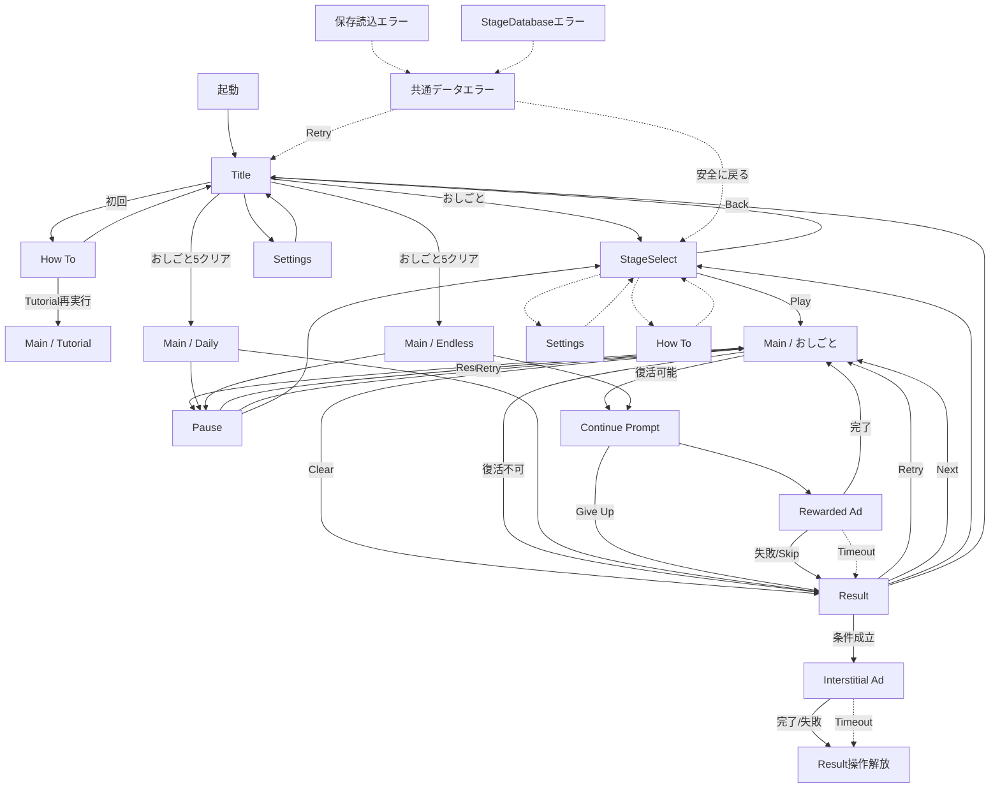

# 画面遷移と状態設計

## 線の意味

- 実線：現在実装済みの基本遷移
- 破線：今回のデザイン・実装追加対象

## 重要状態マトリクス

| 状態 | ブロック対象 | 主表示 | 主操作 | 逃げ道 |
|---|---|---|---|---|
| モードlocked | 対象モード開始 | 解放条件 | なし | おしごと |
| ステージlocked | PLAY | 前面クリア条件 | 別ステージ選択 | Back |
| Pause | Main入力と時間 | 一時停止 | Resume | StageSelect |
| Rewarded loading | 復活の二重実行 | 読込中 | 待機 | Give UpまたはTimeout |
| Rewarded failure | 復活 | 利用不可 | Resultへ | Result |
| Result ad waiting | Result遷移Button | 広告待機 | 待機 | Timeoutで解放 |
| StageDatabase error | ゲーム開始 | 読込失敗 | Retry | Title |
| Daily save reset | ブロックしない | 再作成トースト | なし | 通常続行 |
| Background return | Main入力 | 一時停止案内 | Resume | StageSelect |

## Button優先順位

1. 1画面につき強いPrimary Buttonは原則1つ。
2. Retry、StageSelect、Titleをすべて同じ強さにしない。
3. disabledは透明度だけに頼らず、押せない理由を表示する。
4. loading中はButtonラベルまたは直近に状態文言を出す。
5. Scene遷移開始後は二重タップを受け付けない。

